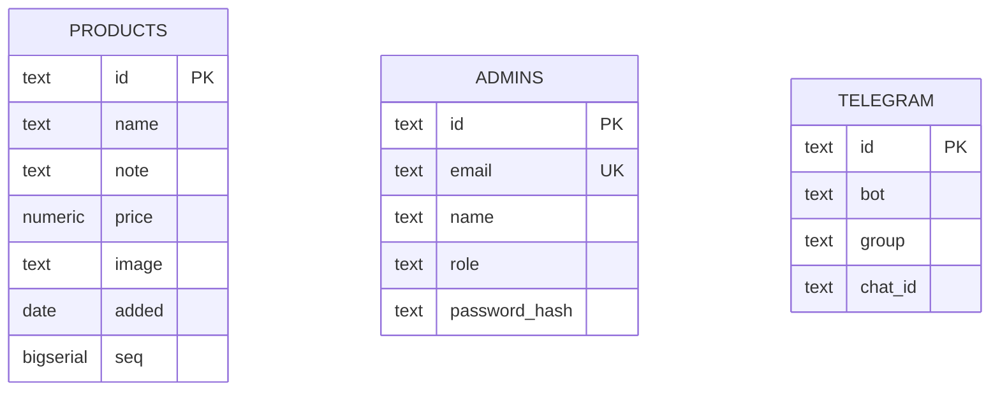

<!-- GENERATED from docs/architecture/erd/ — DO NOT EDIT THIS FILE.
     Every write here is overwritten the next time a story's technical design
     merges. This document is the whole contract and is what every reader,
     review and gate reads; it is assembled from one file per story so that
     twenty stories do not edit one file. Add or change what YOUR story needs
     in docs/architecture/erd/<your-story-slug>.md. -->

# Database Design (ERD) — Shelf

Engine: PostgreSQL 16
Last updated: 2026-11-03
Source requirements: `docs/data/SRS.md`, `docs/auth/SRS.md`, `docs/cms/SRS.md`, `docs/site/SRS.md`

## 1. Overview

Shelf stores three things: the shop's products, the handful of people allowed to sign in and manage them, and the single Telegram target the CMS notifies on a new product. There is no customer account, no order, no cart — the brief rules all of that out. Product photos live on disk under `/images/products/<id>.<ext>`; the database holds only the path string, not the file. All three tables already exist, created by `code/backend/migrations/0001_create_products.up.sql` through `0003_create_telegram.up.sql`; this document is the design record for that schema plus the one column the `auth` module still has to add (`admins.password_hash`).

## 2. Diagram

No relationship line connects these three: nothing in the SRS has `products` reference `admins` (no "created by" field is specified — CMS-001 does not store who added a row) and nothing has `telegram` reference either table (it is a single configuration row the `cms` module reads by convention, not by a foreign key). Three independent tables is the whole schema.

## 3. Entities

### 3.1 `products`

**Purpose** — the shop's catalogue; every row is one item for sale, shown on the public Home page and in the CMS list. **Traces to** — DATA-001, DATA-003 (read/shape), CMS-001, CMS-002 (write, the data the Telegram message quotes), SITE-001, SITE-002 (what the public page renders).

| Column | Type | Null | Default | Unique | Description |
|---|---|---|---|---|---|
| `id` | `text` | no | — | PK | Seed uses a readable slug (`kitchen-scale`); CMS-001 behaviour 4 assigns a new id to a server-written row the same way |
| `name` | `text` | no | — | | Product name — DATA §4.1 data table, CMS-001 |
| `note` | `text` | no | — | | Short description — DATA §4.1, SITE-002 AC-1/AC-2 renders it only when non-empty at the UI layer |
| `price` | `numeric(12,2)` | no | — | | USD, > 0 — CMS SRS data table ("price ... yes ... > 0, USD") |
| `image` | `text` | no | `''` | | Path to the photo, `/images/products/<id>.<ext>`; empty string (not null) is the documented "no photo" state that `ProductImage`'s placeholder slot renders — CMS-001 behaviour 4/5, AC-5 |
| `added` | `date` | no | — | | Server-set on insert (CMS §4.1 data table: "set by the server... not supplied by the client"); drives default ordering — DATA-001 behaviour 2 |
| `seq` | `bigserial` | no | auto | UK (implicit) | Insertion-order tiebreaker so the default read's "seed's insertion order" (DATA-001 behaviour 2) is stable even when two rows share `added`; never exposed in the API response (architecture overview §3) |

**Nullable columns** — none. `image` is `NOT NULL DEFAULT ''`, not nullable: "no photo" and "empty path" are the same state (CMS-001 AC-5), so a sentinel empty string is correct and a null would just push the same check onto every reader.

**Foreign keys** — none.

**Constraints**

| Name | Rule |
|---|---|
| `ck_products_price_positive` | `CHECK (price > 0)` — CMS SRS data table, DATA SRS data table |

**Indexes**

| Name | Columns | Type | Query it serves |
|---|---|---|---|
| (PK) | `id` | btree (implicit) | `GET /v1/products/<id>` — DATA-001 behaviour 3 |

No index on `added`/`seq` is added: DATA-001's non-functional target is 1s for up to 500 rows, and a full-table sort at that size costs nothing worth a second index to avoid. Add `idx_products_added_seq` if the catalogue grows past a few thousand rows.

**Lifecycle** — hard delete. Nothing in the brief or any SRS module offers removing a product (CMS SRS §3 lists "Editing or deleting an existing product" as explicitly out of scope); no delete path exists at all, so there is no soft-delete question to answer yet. Revisit if a future story adds deletion.

---

### 3.2 `admins`

**Purpose** — the owner and shop admins who may sign in; there is no public sign-up and no UI to create or edit a row — the owner inserts and edits these directly in the database (AUTH SRS §7). **Traces to** — AUTH-001, AUTH-002, AUTH-003 (the row sign-in checks against); DATA-002 (never public).

| Column | Type | Null | Default | Unique | Description |
|---|---|---|---|---|---|
| `id` | `text` | no | — | PK | Seed value `owner` for the one real row |
| `email` | `text` | no | — | UK | Matched case-insensitively at sign-in (AUTH-001 behaviour 2); stored as submitted, lowercased on write — see note below |
| `name` | `text` | no | `''` | | Returned in the session; AUTH data table: blank falls back to a name derived from the email at read time, so storage stays `NOT NULL DEFAULT ''`, no null-vs-empty distinction needed |
| `role` | `text` | no | — | | `owner` or `admin` — AUTH data table; carried in the session, not used to gate anything yet (AUTH SRS §3) |
| `password_hash` | `text` | no | — | | **Not yet migrated** — added by the `auth` module's own migration per AUTH SRS §7 and architecture overview §3 ("No `password_hash` column here [yet]"); never null once that migration lands, since every admin row must be sign-in-able the moment it exists (see §9) |

**Nullable columns** — none.

Email case-sensitivity note: the convention catalogue recommends `citext`; this schema keeps `text` with `UNIQUE` and relies on the application to lowercase on write and on read (AUTH-001 behaviour 2 says "matched case-insensitively"), because the existing migration (`0002_create_admins.up.sql`) already shipped `email text NOT NULL UNIQUE` with a non-lowercased seed value (`brian.ng.2305@gmail.com`, already lowercase in practice). Changing the column type now is free; recorded as the simpler of two equally-correct choices.

**Foreign keys** — none.

**Constraints**

| Name | Rule |
|---|---|
| `uq_admins_email` | `UNIQUE (email)` — already created by `0002_create_admins.up.sql` |

**Indexes**

| Name | Columns | Type | Query it serves |
|---|---|---|---|
| (unique, implicit) | `email` | btree | `POST /v1/auth/login` looks up the submitted email — AUTH-001 behaviour 2 |

**Lifecycle** — hard delete, by the owner directly in the database. AUTH SRS §4.1's failure table ("Account removed") says explicitly: no revocation screen exists, an existing session outlives the row's deletion until the session itself expires. No `deleted_at` column is added — there is no UI path that would ever set one.

---

### 3.3 `telegram`

**Purpose** — the single configuration row naming the bot and group the CMS notifies when a product is added. **Traces to** — CMS-002 (reads it to send); DATA-002 (never public).

| Column | Type | Null | Default | Unique | Description |
|---|---|---|---|---|---|
| `id` | `text` | no | — | PK | Fixed value `'group'` — DATA SRS §3: "stored and seeded by the `data` module... one row (`id='group'`)" |
| `bot` | `text` | no | `''` | | Bot token/name from @BotFather; seeded empty, filled in by the owner once the bot exists (architecture overview §3) |
| `group` | `text` | no | `''` | | Human-readable group name; quoted identifier in SQL (`"group"` — reserved word), display-only |
| `chat_id` | `text` | no | `''` | | The Telegram chat id CMS-002 sends to; empty until the owner configures it |

**Nullable columns** — none. All three configuration fields default to `''` and are filled in later by the owner; "not yet configured" and "empty" are the same state, same reasoning as `products.image`.

**Foreign keys** — none.

**Constraints** — none beyond the primary key; a `CHECK (id = 'group')` is not added since nothing but the seed ever inserts into this table and no UI exposes creating a second row.

**Indexes** — none beyond the primary key; the table is read in full, by id, by a single known key — no filtered or joined access path exists.

**Lifecycle** — hard delete is available but unused; this is a singleton configuration row with no deletion path in any SRS module.

## 4. Enumerations

| Name | Values | Mechanism | Why |
|---|---|---|---|
| `admins.role` | `owner`, `admin` | `CHECK` constraint, not yet enforced in the shipped migration | AUTH SRS data table fixes the value set, but the `0002` migration as written has no `CHECK` — recorded as a gap for the `auth` module's migration to close alongside adding `password_hash` (see §9) |

No lookup table: two fixed values that only a deploy, never the business, ever adds to.

## 5. Access patterns

| # | Pattern | Frequency | Index used |
|---|---|---|---|
| 1 | `GET /v1/products?page=&limit=&<field>=` ordered by insertion | every Home page load, every CMS list load | PK scan + in-memory/SQL sort on `seq`; no dedicated index at this row count (see §3.1) |
| 2 | `GET /v1/products/<id>` | occasional, direct record fetch | `products` PK |
| 3 | `POST /v1/auth/login` → lookup by email | every sign-in attempt | `uq_admins_email` |
| 4 | `GET /v1/admins`, `GET /v1/telegram` (full table, admin-only) | rare, CMS/admin tooling only | full scan — table has at most a handful of rows |
| 5 | `POST /v1/products` → read `telegram` row `id='group'` | every product save | `telegram` PK |

## 6. Data volume and growth

| Table | Rows at launch | Growth | Retention |
|---|---|---|---|
| `products` | 12 (seed) | a handful added per week by hand through the CMS | kept forever — no delete path |
| `admins` | 1 (seed, the owner) | the owner adds admins by hand in the database, rarely | kept forever — no delete path, deletion is manual/direct |
| `telegram` | 1 (seed, fixed id) | never grows — singleton | kept forever |

Nothing here approaches a volume where partitioning or archival is a real question; this is a single small shop's catalogue.

## 7. Integrity, privacy, and security

- `price > 0` is enforced by a database `CHECK`, not just client validation (CMS-001 behaviour 2 is the client-side mirror of the same rule) — a direct API call bypassing the form still cannot store a non-positive price (CMS-003 failure table).
- `admins.email` uniqueness is a database constraint, not just an assumption — two admin rows can never collide on the value sign-in looks up.
- `admins.password_hash` holds a password hash only, never plaintext (AUTH SRS §6 Privacy); the hash algorithm is the `auth` module's technical design choice when that column is migrated in, not this document's.
- `admins` and `telegram` rows are personal/operational data never returned to an unauthenticated caller — enforced at the application layer (DATA-002), since PostgreSQL row-level security is not in play here; the SQL `SELECT` for the public `products` endpoint is the one place DATA-003 requires column-level enforcement ("excluded at the SQL level, not in the frontend") and this schema has no private product column today, so nothing is currently excluded.
- No row-level access rule beyond "signed in or not" — AUTH SRS §3 explicitly keeps `role` unused for gating in this release.

## 8. Migrations

| # | Change | Forward | Backward | Safe on non-empty table |
|---|---|---|---|---|
| 1 | Create `products`, seed 12 rows | `0001_create_products.up.sql` (shipped) | `0001_create_products.down.sql` — `DROP TABLE products` | n/a — table created empty then seeded in the same migration |
| 2 | Create `admins`, seed 1 row | `0002_create_admins.up.sql` (shipped) | `0002_create_admins.down.sql` — `DROP TABLE admins` | n/a |
| 3 | Create `telegram`, seed 1 empty row | `0003_create_telegram.up.sql` (shipped) | `0003_create_telegram.down.sql` — `DROP TABLE telegram` | n/a |
| 4 | Add `admins.password_hash` + backfill + `NOT NULL` + role `CHECK` | `0004_add_admins_password_hash.up.sql`: add column nullable, backfill the single seeded `owner` row with a pre-computed hash handed to the owner out of band (AUTH SRS §7's own proposed default), then `ALTER COLUMN password_hash SET NOT NULL`; add `ck_admins_role` as a `CHECK (role IN ('owner','admin'))` in the same migration since it touches the same table | `0004_add_admins_password_hash.down.sql` — drop the `CHECK`, then drop the column | Safe: the table has exactly one row today; add-nullable → backfill → set-`NOT NULL` is the three-step pattern for a populated table, done here on one row |

Migration 4 is the one piece of this schema not yet written; it belongs to the `auth` module's own technical-design step (AUTH SRS §7 names it explicitly), not to this document, but is recorded here since it is the only change this ERD still predicts.

## 9. Open questions

| Question | Owner | Blocking |
|---|---|---|
| Hash algorithm for `admins.password_hash` (bcrypt/argon2/etc.) and who computes the first owner row's hash out-of-band | TL, in the `auth` module's technical design step | no — schema shape (`text`, `NOT NULL` after backfill) holds regardless of algorithm chosen |
| Whether `admins.role` gains real gating behaviour later (owner vs admin pages) | PM / stakeholder | no — AUTH SRS §3 fixes this out of scope for the current release; schema already stores the column either way |

<!-- story 3: Owner & admin sign-in -->
# ERD extension — Owner & admin sign-in

Story: `docs/auth/stories/owner-admin-sign-in.md`
Extends: `admins` (defined in the project-wide `docs/architecture/erd.md` §3.2)

## Change

This story adds the one column the shared ERD already predicted and gave an
open migration slot for (`erd.md` §8, migration 4; §9 open question): a
password hash on `admins`. No new table. No column on `products` or
`telegram`.

### `admins` (extended)

| Column | Type | Null | Default | Unique | Description |
|---|---|---|---|---|---|
| `password_hash` | `text` | no (after backfill) | — | | bcrypt hash of the admin's password; compared against the submitted password at `POST /v1/auth/login`; never returned by any endpoint, never logged |

**Constraint added in the same migration** — `ck_admins_role`:
`CHECK (role IN ('owner','admin'))`, closing the gap `erd.md` §4 already
flagged (the shipped `0002` migration has no `CHECK` on `role`).

No other column on `admins` changes. No foreign key — same as the existing
table.

## Mock shape read and judged

`code/frontend/lib/mock/owner-admin-sign-in.ts` (PR #15) resolves
`{ token, email, name, role }` on a match and rejects with a plain `Error`
otherwise, checking a plaintext password against a hard-coded single-admin
list. This is the UI's stand-in only:

- The `{ token, email, name, role }` resolve shape matches
  `services.md` §3.1's response body exactly — no frontend change needed
  when the backend client replaces it.
- The mock's plaintext password comparison does **not** carry over: the
  real column is `password_hash` (bcrypt), compared server-side. The mock
  never had to decide a hashing scheme because it is not the backend; this
  design decides it below (§ Migration, bcrypt).
- The mock's generic `reject(new Error("UNAUTHENTICATED"))` on either "no
  such email" or "wrong password" matches AUTH-002's one-status rule and
  `services.md` §3.1's single `401 UNAUTHENTICATED` — no departure.

## Hash algorithm decision

`erd.md` §9 left this open. Decided: **bcrypt**, cost 10 — Go's
`golang.org/x/crypto/bcrypt` is the stdlib-adjacent, already-conventional
choice for this stack (no new runtime dependency beyond the one package,
no extra config value, no tuning this project's single-digit admin count
ever needs). Recorded here since this is the migration that adds the
column the algorithm's output has to fit (`text`, a bcrypt hash is ~60
chars, well within).

## Migration plan

| # | Change | Forward | Backward | Safe on populated table |
|---|---|---|---|---|
| 4 | Add `admins.password_hash`, backfill, `NOT NULL`; add `ck_admins_role` | `0004_add_admins_password_hash.up.sql`: `ALTER TABLE admins ADD COLUMN password_hash text;` → `UPDATE admins SET password_hash = '<bcrypt hash of the out-of-band initial password>' WHERE id = 'owner';` → `ALTER TABLE admins ALTER COLUMN password_hash SET NOT NULL;` → `ALTER TABLE admins ADD CONSTRAINT ck_admins_role CHECK (role IN ('owner','admin'));` | `0004_add_admins_password_hash.down.sql`: `ALTER TABLE admins DROP CONSTRAINT ck_admins_role;` → `ALTER TABLE admins DROP COLUMN password_hash;` | Safe: `admins` holds exactly one row (the seeded `owner`) today — add-nullable → backfill → set-`NOT NULL` is the standard safe pattern for a populated table, trivial at one row. `ck_admins_role` adds no risk: the existing seed value (`owner`) already satisfies it. |

The out-of-band initial password for the `owner` row is communicated to the
owner once by Dev at merge time (per the story's own decision on the SRS's
open question) — not part of the SQL, a deploy-time step.

